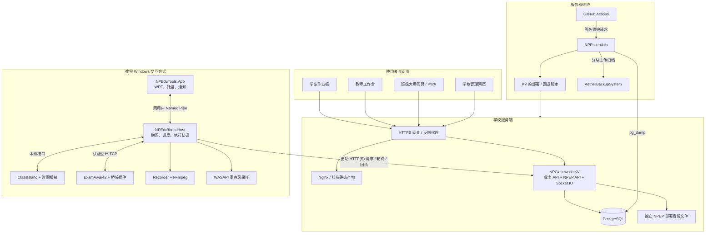
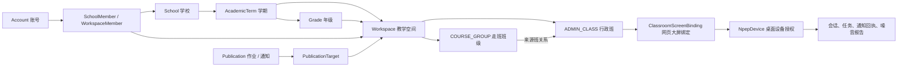
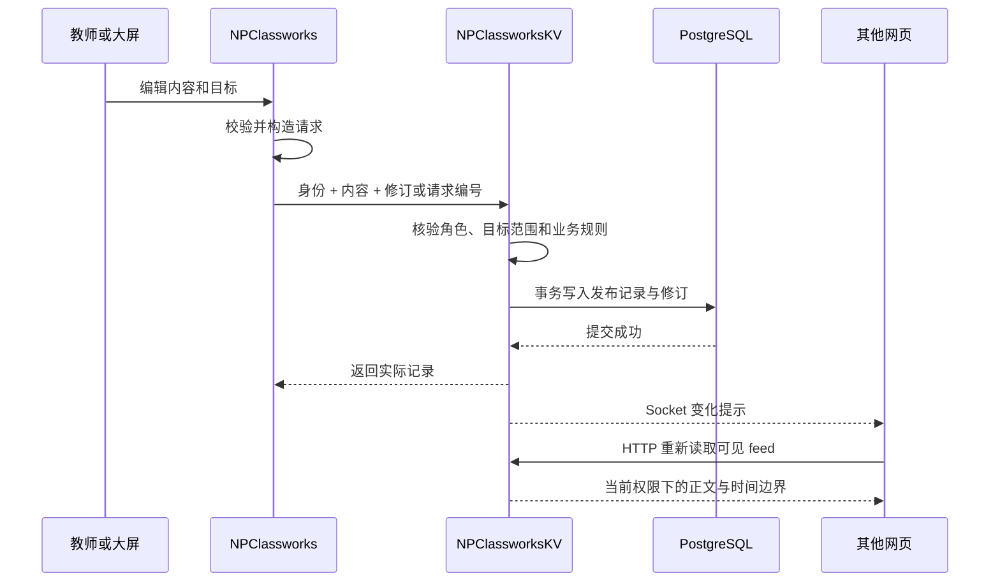
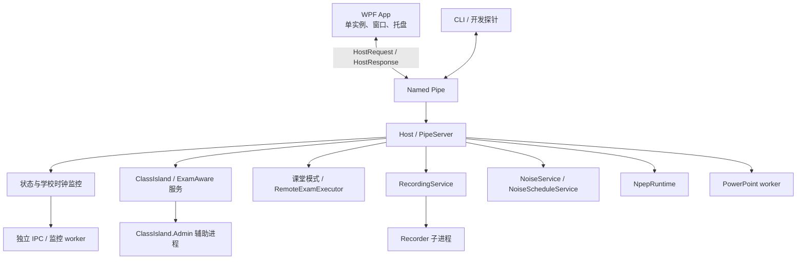
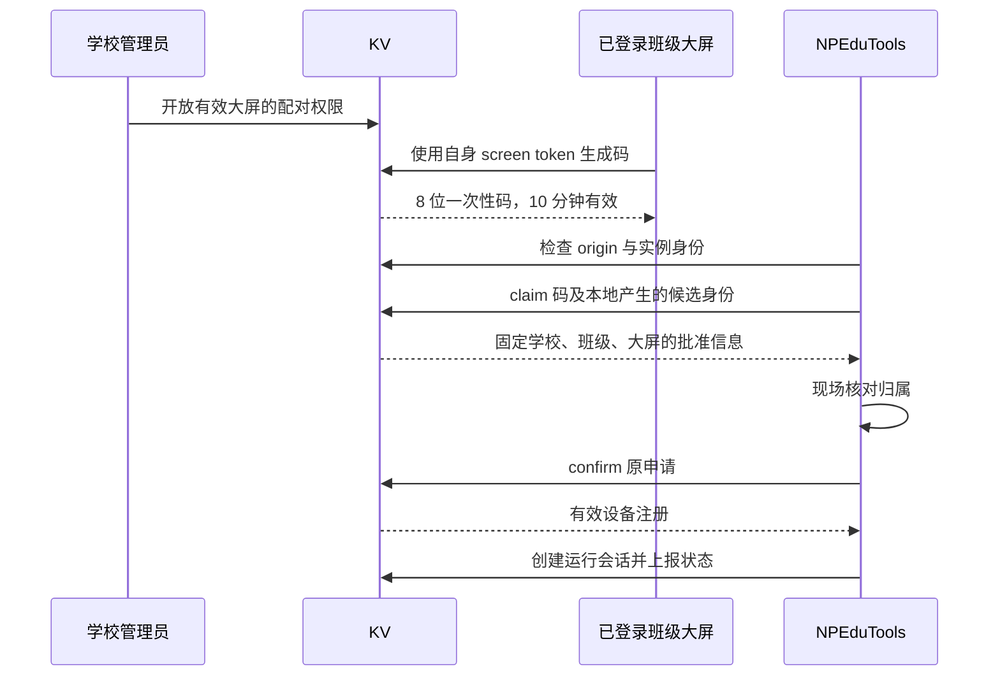
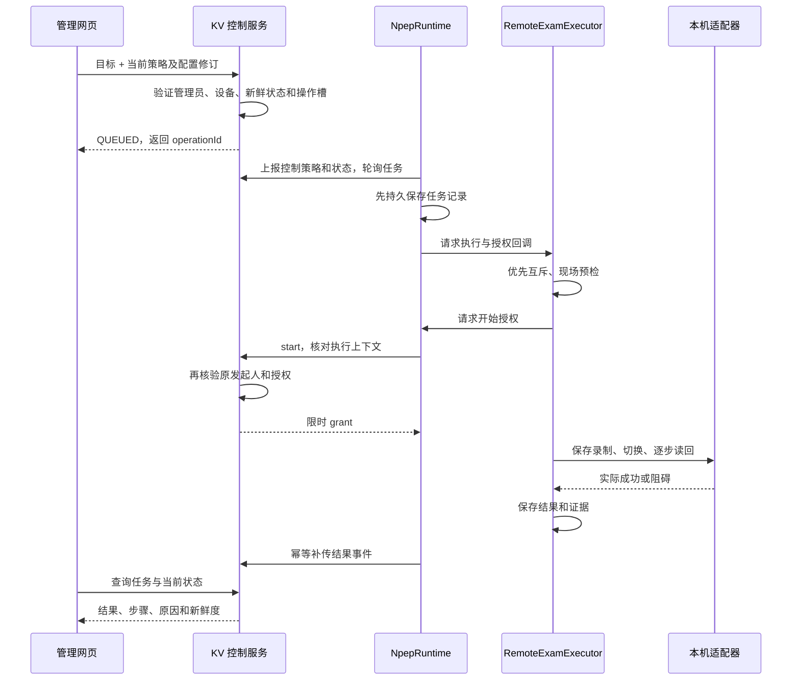
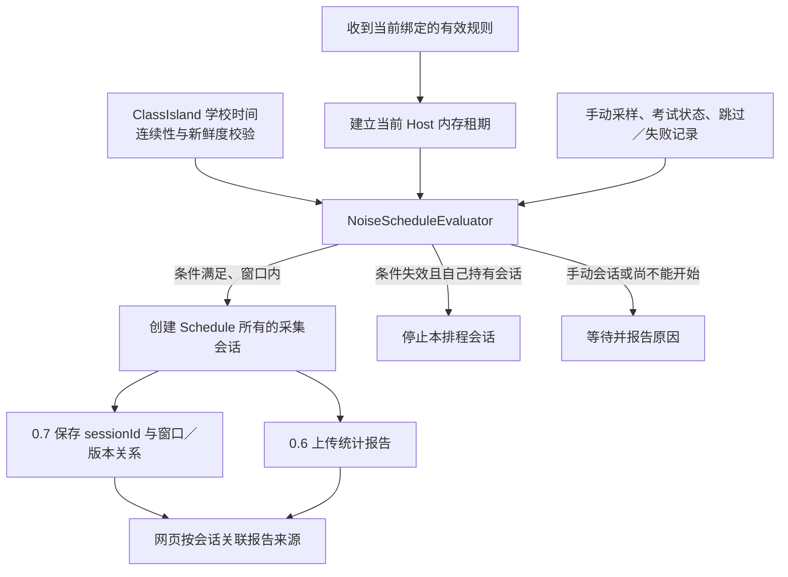
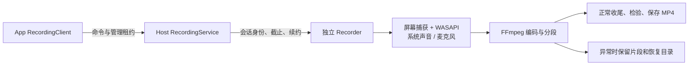

# NPEP 生态综合架构：项目关系、业务逻辑与运行机制

编写日期：2026-10-03（Asia/Shanghai）

审阅方式：以本地实际源码、协议、数据库迁移、构建配置及历史验收记录交叉核对。

适用对象：需要理解整体系统、继续开发、排查跨端问题或组织发布的维护者。

**NPEP（NOVARK POWER EDUCATION PLUS）是连接学校业务系统与教室 Windows 执行端的一组协作能力。NPClassworks 提供网页交互，NPClassworksKV 保存业务数据并判定授权，NPEduTools 执行本机操作、采样并报告事实；NPEssentials 负责服务器部署与异地备份。**

它没有独立的“NPEP 服务进程”或第五个核心业务仓库。服务端实现嵌在 NPClassworksKV 中，网页入口嵌在 NPClassworks 中，设备联网层与执行层位于 NPEduTools 中。ClassIsland、ExamAware2、PowerPoint、FFmpeg 和 PostgreSQL 是不同位置上的外部依赖。

本文描述的是**下列源码基线及明确注明的工作区状态**，不是线上服务的实时盘点，也不是一次完整安全审计。历史测试、真实设备验收、发布附件和服务器部署分别陈述。

## 目录

- [1. 阅读范围与源码基线](#scope)
- [2. 整体关系与数据所有权](#system)
- [3. NPClassworks：网页业务与状态管理](#web)
- [4. NPClassworksKV：授权、业务和协议服务](#backend)
- [5. NPEduTools：Windows 进程与执行架构](#desktop)
- [6. NPEP 协议、身份和代际](#protocol)
- [7. 配对、状态与通知](#pairing-notifications)
- [8. 考试环境与考试方案](#exam)
- [9. 噪音监测与学校排程](#noise)
- [10. 桌面本地功能如何运转](#local)
- [11. NPEssentials：部署代理与备份](#essentials)
- [12. 存储、部署与故障恢复](#operations)
- [13. 开发、验证与当前边界](#verification)
- [14. 源码阅读索引与术语](#index)

## 1. 阅读范围与源码基线

### 1.1 本次采用的版本

| 项目 | 采用的源码 | 本次开始审阅时的状态 |
| --- | --- | --- |
| NPEduTools | `codex/auto-recording-page-20261003`，HEAD `3f7b24e76ebad13829294aa0cc607b6c573da692` | 包含已有未提交改动：自动录课页面、相关脚本、README 与开发文档整理。本文涉及这些页面时按工作区说明，不把它们视作 HEAD 内已发布内容。 |
| NPClassworks | `codex/npep-preauthorized-pairing-20261003`，HEAD `cc9c1a14ebf986f4ace6828f1715f7d02d3f7310` | 工作区干净。 |
| NPClassworksKV | `codex/npep-preauthorized-pairing-20261003`，HEAD `e83218d7370c586b6b42113ef44b778e9ee61c2d` | 工作区干净。 |
| NPEssentials | **只采用默认主分支** `master`，提交 `20351705c75952c4ddf8e870f3cbcad80899d421` | 按用户“只考虑 main 分支”的要求限定为主分支。2026-10-03 通过远端引用核实：`HEAD → refs/heads/master`，远端没有 `refs/heads/main`；本地 `master` 与远端一致。其他分支内容全部排除。 |

NPEssentials 的检查使用 `git show master:<文件>`，没有切换工作区、合并分支或修改该仓库。本文不采纳它其他分支中的执行器、请求协议或部署设计。

### 1.2 范围与证据规则

核心范围是以上四个项目。对 ClassIsland、ExamAware2 等外部项目，只解释本生态使用的接口、适配器和已记录的兼容边界，不声称审阅了它们的全部源码。

`Research` 下的 Datedu/C30 等资料属于研究输入。本次在 NPEduTools 的 `src`、`plugins` 中未找到它们的直接代码引用，不把这些研究样本画成当前运行组件。

遇到记录冲突时，采用以下顺序：

1. 当前实际路由、服务、Host 装配、契约和迁移，决定“源码现在实现了什么”。
2. 带日期的后续产品规则，解释实现语义为何变化。
3. 历史验收记录只证明其对应版本与环境中的结果。
4. 早期架构草案用于解释起点，不直接作为当前功能清单。

例如，早期资料中的“N3 只是设计”“不修改自启动”“必须另外开启本地许可”“通知通过 ClassIsland 展示”，均不足以描述本次源码。现在已有完整考试／日常切换、配对派生授权、独立 WPF 通知、原生噪音监测与学校排程。

主要依据：[最初的 NPEP 定位](NPEP-FOUNDATION-PLAN.md)、[后续规则索引](npep/README.md)、[当前后端路由](../../NPClassworksKV/routes/v2/npep.js)。

## 2. 整体关系与数据所有权

### 2.1 四个项目分别承担什么

| 项目 | 产品责任 | 主要技术与运行位置 | 负责确认的事实 |
| --- | --- | --- | --- |
| NPClassworks | 学生作业板、教师发布、班级大屏、学校管理、NPEP 操作界面 | Vue 3、Vuetify 3、Pinia、Vite、PWA；浏览器 | 当前界面、用户输入、本地草稿和离线队列；设备执行结果以服务端读回为准。 |
| NPClassworksKV | 账号、组织、教学空间、发布记录、设备授权、NPEP 任务及统计 | Node.js、Express、Prisma、PostgreSQL、Socket.IO；服务器 | 业务数据、权限、请求是否受理、设备上报过哪些结果及其时间。 |
| NPEduTools | 快捷工具、PPT 辅助、录课、日常／考试切换、通知和噪音采集 | C#、.NET、WPF、Windows IPC、隔离工作进程；教室电脑 | 软件与桥接是否就绪、模式切换步骤、录制文件、麦克风采样和本机执行日志。 |
| NPEssentials | 配套网站升级、任务串行化、异地数据库备份 | Go 标准库、Bash、PostgreSQL 客户端；服务器 | 升级脚本退出结果、备份任务状态、异地提交回执。 |

上表中的依赖版本来自仓库配置，不表示外部组件的最新发行版。前后端 `package.json` 当前均声明 `1.2.0 / Hitori`；桌面应用配置声明 `0.1.0-indev.20261002`，默认 SDK 为 `10.0.400`。

### 2.2 总体拓扑

浏览器可以关闭，Host 仍能在自身运行期间访问学校服务。学校服务器不需要向教室电脑开放入站控制连接。考试切换与噪音命令走设备 HTTP 轮询，Socket.IO 主要服务网页数据变化提示。

部署代理属于运维通道，不参与教师发布、NPEP 设备授权或每一次桌面执行。

### 2.3 学校业务对象与设备对象

这是逻辑关系图，不等同于所有 Prisma 外键的逐项复制。

- **学校与学期限定业务空间。** “高二 5 班”必须归属具体学期，不能只依赖同名文本识别。
- **教学空间统一承载发布目标。** 枚举还包含年级／学校频道；当前主要使用行政班与走班班级。
- **学科归属由显式规则决定。** `AdministrativeClassSubject.deliveryMode` 指明跟行政班还是选走班，`WorkspaceSourceClass` 说明走班班级来自哪些行政班。
- **教师职责和权限不是同一个对象。** `TeachingAssignment`、年级／班级负责人表达教学关系；`SchoolMember`、`WorkspaceMember` 等参与授权判断。
- **网页大屏与桌面设备有两套身份。** 它们通过同一个 `screenBindingId` 关联，但凭据、心跳、状态与撤销规则各自存在。

依据：[数据库模型](../../NPClassworksKV/prisma/schema.prisma)、[选科规则](../../NPClassworksKV/domain/academicCatalog.js)、[大屏服务](../../NPClassworksKV/services/classroomScreenService.js)。

### 2.4 谁拥有最终状态

| 数据或状态 | 权威位置 | 其他端持有的内容 |
| --- | --- | --- |
| 学校、学期、账号角色、教学关系 | PostgreSQL | 网页读取结果或本地选择缓存 |
| 作业、通知、目标、修订、认证 | PostgreSQL | 网页 feed、草稿、离线副本；桌面通知快照 |
| 网页待上传作业 | 对应浏览器的本地队列 | 上传成功前不属于共享发布数据 |
| NPEP 学校／班级授权 | 服务端部署门闩与数据库 | 桌面受保护凭据及绑定上下文 |
| 当前软件、录制、采样 | Windows 端实际观测 | 服务端有时间戳的最近报告 |
| 管理员的目标请求 | 服务端任务记录 | 桌面领取后保存的操作记录 |
| 外部软件实际成功与否 | 执行器及适配器读回 | 网页只呈现结果与新鲜度 |
| 噪音排程规则 | 服务端规则及有效版本 | Host 内存中的有限租期规则 |
| 学校时间 | ClassIsland 时间桥接及连续性校验 | 本机调度使用的日历时间 |
| 发布结果、备份结果 | 部署脚本记录／NPEssentials 回执 | CI 摘要、运维查询 |

因此，“请求成功”“过去执行成功”“此刻仍处于目标状态”必须分别判断。

## 3. NPClassworks：网页业务与状态管理

### 3.1 工程结构

NPClassworks 是一个 Vue PWA，由同一个应用提供学生、教师和班级大屏体验，学校管理和初始化使用独立页面。业务语言是 JavaScript，组件同时存在 Composition API 与 Options API 写法。

| 层次 | 主要入口 | 职责 |
| --- | --- | --- |
| 启动与外壳 | `src/main.js`、`App.vue`、`plugins/` | OAuth 回调处理、Vue 装配、全局提示、背景与恢复入口 |
| 路由 | `src/pages/`、`router/index.js` | 首页、学校管理、初始化、设置及兼容跳转 |
| 业务界面 | `components/v2/` | 作业展示、教师发布、大屏录入、通知、课堂工具 |
| 管理界面 | `components/admin/`、`composables/admin/` | 学校结构、账号、大屏、设备、考试和排程管理 |
| 共享状态 | `stores/classworksV2.js` | 一个 `classworks-v2` Store，组合不同职责的 action |
| API 边界 | `utils/classworksV2Client.js` | 账号／大屏凭据、HTTP 方法、错误和会话隔离 |
| 实时同步 | `utils/socketClient.js` | 单例连接、工作区订阅、凭据更新、失效提示 |
| 本地持久化 | `screenOfflineCache.js`、`screenPublicationQueue.js` 等 | 离线展示、草稿、补传、设置 |
| 静态离线资源 | `src/sw.js`、Vite PWA 配置 | 预缓存和资源更新；API 请求使用 NetworkOnly |

前端分析 SDK 由构建开关控制，默认虚拟模块为空实现；不能仅凭依赖中存在 SDK 就认定它默认运行。具体入口见 [main.js](../../NPClassworks/src/main.js)。

### 3.2 启动与三种使用方式

入口先处理已有账号和 OAuth 回调，再注册框架插件、挂载页面。首页 `ClassworksHome.vue` 协调首次使用引导及三类身份。

| 使用方式 | 主要逻辑 |
| --- | --- |
| 学生 | 选择学校、学期、行政班及适用走班空间，读取对应 feed；完成标记等个人状态保存在本机。 |
| 教师 | 通过账号获得可访问空间，发布、修改、认证作业和通知，查看修订、模板及待处理事项。 |
| 班级大屏 | 通过独立大屏账号登录，固定对应行政班与适用空间，进行快速录入、离线展示、课堂工具和通知回执。 |
| 学校管理 | 配置组织、教师职责、账号、大屏、NPEP 配对授权、考试和噪音规则；实际权限由服务端再判定。 |

同一个浏览器可以保有不同使用上下文；实现通过会话版本、请求版本和作用域核对，避免账号或班级切换后旧响应覆盖新界面。

### 3.3 Store 的内部组织

`classworks-v2` 没有简单拆成“学生 Store／教师 Store／大屏 Store”。它集中定义 state 与 getters，再组合以下 action：

- `boardActions.js`：学生选择、日期、feed、订阅、刷新。
- `teacherActions.js`：教师会话、发布、认证、目标偏好和行动中心。
- `screenSessionActions.js`：大屏登录、缓存会话、名单考勤及保存入口。
- `screenSyncActions.js`：连接状态、心跳、远程网页指令、队列补传。

这些模块通过同一个 Store 的 action 协作。管理页面另用 composable 管理自身编辑过程，例如 `useNpepManager`、`useNpepRuntimeControl`、`useNpepExamPlans`、`useNoiseScheduleEditor`。

依据：[Store 装配](../../NPClassworks/src/stores/classworksV2.js)、[状态边界说明](../../NPClassworks/docs/frontend-state-boundaries.md)。

### 3.4 作业与通知的端到端逻辑

四种时间不能混用：

| 字段 | 用途 |
| --- | --- |
| `boardDate` | 作业属于哪一天的作业板 |
| `publishAt` | 内容何时可以公开出现 |
| `dueAt` | 作业截止时间 |
| `expiresAt` | 通知何时退出有效展示范围 |

未来发布或到期变化不一定伴随人工写入，因此 feed 带有 `nextTransitionAt`，前端除 Socket 提示外也需要时间驱动刷新。周视图、明日作业、预习、假期作业、订正等是在同一发布模型上的业务规则，不是多个独立后端。

`contentJson` 保存结构化附加信息。比如“无作业”标记、预习或订正元数据必须与实际文本一致；普通保存、冲突处理和复制保存都不能绕过共同校验。

依据：[发布服务](../../NPClassworksKV/services/publicationService.js)、[大屏编辑器](../../NPClassworks/src/components/v2/ScreenHomeworkDialog.vue)、[发布领域规则](../../NPClassworksKV/domain/publication.js)。

### 3.5 离线与多窗口边界

大屏先保留可用展示数据和编辑草稿，暂时性网络失败时可将符合条件的写入放入队列。队列按绑定标识隔离，保留稳定的 `clientRequestId`；后端用绑定、请求编号及请求内容摘要避免重复创建。

恢复连接后先核对当前会话，再补传。业务冲突、权限问题或其他不可自动重试的错误进入 `needs_review`，不能无限重发或静默覆盖服务端修订。跨标签页存储锁用于协调队列修改。

当前队列上限为 50 项、保留 7 天；feed 缓存另有数量、字节及过期限制。这些是局部缓存策略，不能当作完整业务备份。

Service Worker 缓存静态应用资源；认证 API、Socket、健康检查与指标使用 NetworkOnly。离线业务数据由显式缓存模块管理。

大屏心跳还可领取 `REFRESH_DATA`、`RELOAD_APP` 等**网页操作**；这条通道与 NPEP 控制 Windows 软件的通道分开。

依据：[离线队列](../../NPClassworks/src/utils/screenPublicationQueue.js)、[补传协调](../../NPClassworks/src/stores/classworksV2/screenSyncActions.js)、[SW](../../NPClassworks/src/sw.js)。

## 4. NPClassworksKV：授权、业务和协议服务

### 4.1 它已经是学校业务后端

“KV”保留了项目历史名称。当前后端承担组织、账号、教学关系、发布、设备和 NPEP 业务；旧 UUID/KV、应用安装与旧设备授权通道已经退役。遗留表和历史迁移仍保留，不能把表存在等同于 HTTP 功能仍开放。

部署形态是**模块化单体**：Express API、Socket.IO、发布历史清理和 NPEP 维护在同一 Node 进程内运行。当前装配没有独立消息队列服务、单独业务 worker 或跨实例 Socket adapter。

| 层次 | 主要内容 |
| --- | --- |
| 进程装配 | `bin/www` 创建 HTTP Server、Socket.IO 与后台维护，并处理退出。 |
| HTTP 装配 | `app.js` 配置跨域、指标、正文解析、路由、存活／就绪检查和错误处理。 |
| 路由 | `routes/accounts.js`、`routes/v2/`；负责请求边界与调用服务。 |
| 服务 | `services/`；负责授权、事务、查询、幂等和跨对象一致性。 |
| 领域规则 | `domain/`；负责数据归一化、业务计算、协议与 Schema 校验。 |
| 数据访问 | Prisma 7、`@prisma/adapter-pg`、`pg`、`schema.prisma` 与 SQL 迁移。 |
| 基础设施 | `utils/`、`middleware/`；账号令牌、Socket、限流、指标、CORS 等。 |

依据：[进程入口](../../NPClassworksKV/bin/www)、[应用装配](../../NPClassworksKV/app.js)、[依赖声明](../../NPClassworksKV/package.json)。

### 4.2 路由与领域划分

| HTTP 入口 | 业务责任 | 服务示例 |
| --- | --- | --- |
| `/accounts` | 登录、刷新、退出、本地账号及 OAuth | `localAccountService`、`tokenManager` |
| `/api/v2/setup` | 初始化会话、首位管理员、学校与初始配置 | `instanceSetupService` |
| `/api/v2/catalog` | 学校、学期、行政班和选科目录 | `academicCatalogService` |
| `/api/v2/me` | 当前账号、空间和职责视图 | 授权及账号偏好服务 |
| `/api/v2/admin` | 组织、教师、账号、名单、审计、迁移等管理 | 组织、职责、学校管理服务 |
| `/api/v2/publications` | 发布、修订、认证、feed、历史与恢复 | `publicationService` |
| `/api/v2/classroom-screens` | 大屏登录、身份、心跳、课堂工具与写入 | `classroomScreenService`、`classroomScreenDutyService` |
| `/api/v2/npep` | NPEP 各子协议 | `npepService` 及通知、模式、方案、噪音子服务 |

NPEP 路由在通用 JSON 解析器和通用访问日志之前挂载，使用自己的严格解析和错误信封，避免通用中间件改变协议或泄露敏感请求内容。

### 4.3 权限分层

账号 JWT 用于证明调用者身份；持久化 `AccountSession`、`tokenVersion`、禁用状态和学校／空间成员关系决定该身份现在还能做什么。

| 身份 | 授权依据 | 典型操作 |
| --- | --- | --- |
| 学校 OWNER／ADMIN | 当前账号会话 + `SchoolMember` | 学校管理、配对批准／预授权、远程考试、排程管理 |
| 教师及教学空间成员 | 学校／空间关系、角色和目标范围 | 发布、修改、认证有权限的教学内容 |
| 网页大屏 | 专属 token、凭据版本、有效绑定／班级／学期 | 自身 feed、限定写入、心跳、自身配对码、原生噪音请求 |
| NPEP 桌面设备 | 独立设备 secret、部署代际、绑定修订、有效期与当前会话 | 状态上报、读取通知和已授权任务、上传结果 |

重要写入在事务内重新检查授权。例如，大屏写入锁定并复核绑定；NPEP 设备操作锁定学校、学期／班级／绑定、设备，并检查独立部署身份。开始考试操作时，还要复查原发起管理员的会话和角色。

网页按钮是否显示，只决定交互方式，不是权限保证。

依据：[账号会话](../../NPClassworksKV/utils/tokenManager.js)、[大屏写权限](../../NPClassworksKV/services/screenWriteAuthorization.js)、[NPEP 身份事务](../../NPClassworksKV/services/npepService.js)。

### 4.4 发布、修订与数据一致性

`Publication` 保存当前版本；`PublicationTarget` 关联目标教学空间；`PublicationRevision` 保存修订证据与历史快照。更新使用 `expectedRevision`，发生并发时返回冲突，由用户核对，不默认最后一次写入覆盖一切。

发布、认证、撤回、恢复都会按照业务规则处理修订和目标。恢复历史生成新的当前修订，并不倒转整个数据库。

历史记录也有保留边界：已有清理服务会清理满足条件的旧、未认证、目标已停用的作业修订正文，同时保留必要记录。README 中“备份”字样不能理解为所有历史正文永久保存。

大屏新建另有请求幂等记录；通知网页回执使用 `NotificationScreenDelivery`，NPEP 通知回执使用独立表。

### 4.5 实时事件与后台工作

Socket.IO 按工作区订阅变化。带内部发布标识与修订的事件在发送时检查账号／大屏当前权限；匿名或无相应权限的订阅者，只能收到适用的公开 `publication.feed.changed` 刷新信号。正文仍通过 HTTP 可见性查询获得。

后台维护包括发布修订清理、过期配对／票据、会话回执、NPEP 通知证据、噪音报告等有界清理。NPEP 清理使用数据库 advisory lock 避免多个进程同时执行同一轮，但这不代表整个系统已经具备多实例实时部署能力。

`/check` 表示进程存活，`/ready` 额外执行数据库查询，`/metrics` 使用指标鉴权。任何一个健康接口通过，都不能证明实际教室软件已切换或麦克风正在采样。

依据：[Socket 授权](../../NPClassworksKV/services/socketEventAuthorization.js)、[Socket 分发](../../NPClassworksKV/utils/socket.js)、[历史清理](../../NPClassworksKV/services/publicationRevisionCleanupService.js)、[NPEP 维护](../../NPClassworksKV/services/npepMaintenanceService.js)。

## 5. NPEduTools：Windows 进程与执行架构

### 5.1 实际工程划分

NPEduTools 是有本地独立功能的桌面产品，同时承载 NPEP 设备端。它不是单纯的网页控制代理。

| 工程或目录 | 当前职责 |
| --- | --- |
| `NPEduTools.App` | WPF 主界面、侧边栏、托盘、引导、快捷启动、设置、通知展示及 Host 客户端 |
| `NPEduTools.Host` | 常驻执行协调、状态缓存、学校联网、模式切换、录课控制、噪音及学校排程 |
| `NPEduTools.Contracts` | Host 请求／响应、Named Pipe 帧、录制、考试、噪音等 DTO 与边界校验 |
| `NPEduTools.Core` | 学校时间连续性、录课规则与账本、噪音计算、排程计算及跨进程操作锁等 |
| `NPEduTools.Integrations.ClassIsland` | 课程状态、学校时钟、今日及未来课表的 IPC 读取与形状校验 |
| `NPEduTools.ClassIsland.Bridge.Contracts` | 与 ClassIsland 插件共用的桥接契约，目标框架单独为 net8.0 |
| `plugins/NPEduTools.ClassIsland.Bridge` | 运行在 ClassIsland 内的只读学校时间和课表提供方 |
| `NPEduTools.ClassIsland.Admin` | 隔离的管理员辅助进程：ClassIsland 启动任务、运行状态及限定操作 |
| `NPEduTools.Integrations.Npep` | HTTP 协议、设备生命周期、凭据、通知收件箱、控制及方案日志 |
| `plugins/npedutools-examaware-bridge` | ExamAware 官方插件：认证本机连接、状态、自启动、正常退出、方案与播放器 |
| `NPEduTools.Recorder` | 独立录制进程：音频采集、编码工具控制、分段、收尾与文件恢复 |
| `NPEduTools.PowerPoint.Diagnostics` | PowerPoint 状态与输入观察、翻页辅助、工作进程及诊断 |
| `NPEduTools.PowerPoint.Assist` | 单独的辅助界面项目；常规 Host 另可启动自己的 PowerPoint worker |
| `NPEduTools.Cli`、`tools/`、`tests/` | 运维／开发客户端、协议探针、隔离宿主与测试设施 |

主工程默认 net10.0，WPF 与录制工程指定 Windows 目标；ClassIsland 插件及桥接契约按其宿主兼容要求单独选择框架。Host 在入口检查 Windows，不是跨平台设备守护进程。

早期 `ARCHITECTURE.md` 中的通用 Capability／Scene 是设计背景。当前实现的核心是明确列出的能力名、专用服务与领域状态机，不能将它描述为已经完成的通用插件执行平台或通用 Scene 引擎。

### 5.2 启动、IPC 与生命周期

App 解析启动参数后先检查提权与已有 Host，再处理单实例激活。默认管道名包含 Windows 用户 SID 与交互会话 ID；App 和 Host 各有单实例互斥。

App／CLI 与 Host 使用 4 字节小端长度前缀的 UTF-8 JSON，协议版本为整数 `1`，帧上限 64 KiB。解析拒绝未知成员；`Protocol.Validate` 限定能力名、参数组合、请求 ID 和超时。Named Pipe 使用 `CurrentUserOnly`。

这套 **本机 IPC 版本 1** 与 NPEP **HTTP 0.1–0.7** 是两个不同版本空间。

Host 装配所有执行服务；可能阻塞的第三方 IPC 或 COM 工作放在隔离工作进程中。部分监控 worker 依靠 stdin 租约确认 Host 仍在，孤儿工作进程不会无限保活。

关闭或收起管理窗口通常保留 App 与托盘。App 进程完全退出／卡死和仅隐藏窗口不同：录课管理租约会到期，录制受保护停止；Host 的 NPEP 收发则属于 Host 自身任务。通知的实际窗口展示需要 App 存活且交互桌面可用。

依据：[Host 装配](../src/NPEduTools.Host/Program.cs)、[App 启动](../src/NPEduTools.App/App.xaml.cs)、[管道服务](../src/NPEduTools.Host/PipeServer.cs)、[本机协议](../src/NPEduTools.Contracts/Protocol.cs)、[管道身份](../src/NPEduTools.Contracts/PipeEndpoint.cs)。

### 5.3 为什么状态读取与实际操作分开

学校基础上报使用 `host.cached-status` 对应的已有状态，不因为每次上报去启动软件、打开麦克风或重新做危险探测。`NpepStatusReader` 将本机状态映射为受限的协议枚举，无法确认的内容保持 UNKNOWN。

需要产生副作用时，进入相应服务：录课交给 `RecordingService`，本地模式交给 `ClassroomModeService`，远程考试交给 `RemoteExamExecutor`。实际程序路径、配置修订、进程身份、桥接连接和结果读回由适配器核实。

`RuntimeOperationGate` 与 `RuntimeOperationFile` 协调 Host 内和跨进程操作。普通操作不能在模式切换中插入；远程考试优先请求会阻止新普通操作，并等待已有占用释放。锁要保留到实际后台动作结束，不能在 IPC 返回“受理”后立即释放。

依据：[状态映射](../src/NPEduTools.Integrations.Npep/NpepStatusReader.cs)、[运行互斥](../src/NPEduTools.Host/RuntimeOperationGate.cs)、[跨进程锁](../src/NPEduTools.Core/RuntimeOperationFile.cs)。

### 5.4 外部软件适配

| 外部软件 | 使用方式 | 当前边界 |
| --- | --- | --- |
| ClassIsland | 官方 IPC 读取课程；配套插件提供有效学校时间与课表；管理员 helper 管理限定启动任务和运行切换 | 桥接声明适配 2.1.0.1，时间桥接版本 0.2.0.0；不通过插件修改课表或校时。 |
| ExamAware2 | 官方 Plugin API V2／SDK；插件反向连接 Host 的回环 TCP，完成认证、序号与签名校验 | 桥接 0.4.0 对应 1.5.2；只提供已定义动作，不接收远程任意 shell。 |
| PowerPoint | 独立 worker 观察放映、输入和 COM 状态，执行触摸翻页辅助 | 真实触屏、不同版本、多屏与长期运行仍须具体设备验证。 |
| FFmpeg／ffprobe | Recorder 调用媒体工具编码、收尾与检验 | 构建依赖、随包文件和用户已安装版本需要分别核对；不能由源码路径推断发行包一定包含工具。 |

ExamAware 桥接的配对文件与学校 NPEP 配对是两套关系。前者授权同机插件连接 Host；后者授权设备连接学校服务。完成其中一项不能替代另一项。

依据：[ClassIsland 桥接](../plugins/NPEduTools.ClassIsland.Bridge/README.md)、[ExamAware 桥接](../plugins/npedutools-examaware-bridge/README.md)、[ExamAware 服务](../src/NPEduTools.Host/ExamAwareService.cs)。

## 6. NPEP 协议、身份和代际

### 6.1 分通道版本，而非一个整体“升级版本”

共同 HTTP 前缀为 `/api/v2/npep`。路由按功能确定必须携带的 `X-NPEP-Version`，版本不匹配返回 `PROTOCOL_UNSUPPORTED`。

| 通道 | 当前版本 | 代表性接口或动作 |
| --- | --- | --- |
| N1 基础、两种配对与预授权 | `0.1` | `info`、`pairings`、`pairings/claim`、`device/me`、`device/sessions`、`device/status`、revoke |
| N2 桌面通知 | `0.2` | `device/notifications`、`device/notification-receipts` |
| 早期运行控制 | `0.3` | 历史契约；不是当前新执行的有效控制版本 |
| N3 完整考试／日常切换 | `0.4` | `runtime-control-policy`、`runtime-status`、`runtime-operations`、开始授权与结果事件 |
| ExamAware 方案 | `0.5` | `exam-plan-status`、`exam-plans`、校验、start、grant、result |
| 原生噪音监测 | `0.6` | `screen/noise`、`screen/noise/commands`、`device/noise-exchange` |
| 学校噪音排程 | `0.7` | 学校规则、预览／保存、`device/noise-schedule`、当前窗口恢复 |

N1 的 `supportedCapabilities` 仍为 `["device.status"]`。后续能力通过各自通道、策略及支持标志约定，不能仅看这一数组就断言设备只支持状态，也不能把字段改成任意远程命令列表。

文档中的阶段号也不等同于协议版本：例如 `n4-exam-plan.schema.json` 实际属于考试方案 0.5，而后来的 N4 迭代主要讨论噪音监测。维护时应同时看功能名称、路由、版本及 Schema。

### 6.2 公共消息边界

- GET 使用 UUID v4 的 `X-Request-Id`；POST 使用正文 `requestId`，若也带请求头则二者必须一致。
- 成功响应包含 `protocolVersion / requestId / serverTime / data`；错误使用独立错误信封。
- 所有 NPEP 响应标记 `Cache-Control: no-store`。
- 服务端 N1 请求正文上限 16 KiB，其余通道 64 KiB；客户端也有响应大小边界。
- 严格 UTF-8／JSON 解析拒绝重复键、异常字符串与不合约字段；文本限制还按 JS／.NET 一致的 UTF-16 单元校验。
- 设备客户端只访问固定路由，不跟随重定向，不用 Cookie 保存身份。
- 当前客户端接受 HTTP 和 HTTPS 的 origin，拒绝路径、查询、账号信息等混入地址；HTTPS 保持证书验证。HTTP 的实际传输没有 TLS 保护。

正文格式正确只证明结构符合契约。身份、并发、有效期、授权和执行结果还要经过服务与执行器检查。

依据：[路由版本与解析](../../NPClassworksKV/routes/v2/npep.js)、[公共校验](../../NPClassworksKV/domain/npep/wire.js)、[设备 HTTP 适配器](../src/NPEduTools.Integrations.Npep/NpepApi.cs)。

### 6.3 不能互换的身份与版本

| 标识或版本 | 解决的问题 |
| --- | --- |
| `serverInstanceId` | 区分学校服务实例，防止连接到不同服务器仍沿用原身份。 |
| `deploymentEpoch` | 区分服务端授权代际，尤其防止数据库恢复复活旧设备授权。 |
| `installationId` | 标识本机安装身份；不是管理员账号。 |
| `deviceId` | 服务端设备记录标识。 |
| `screenBindingId / bindingRevision` | 固定设备对应哪个网页大屏及其归属版本。 |
| `credentialId / credentialGeneration` | 标识设备凭据；当前基础注册使用 generation 1。 |
| `runId / sessionId / statusEpoch` | 区分当前设备运行与上传会话，替代会话后旧上传失效。 |
| `sequence` | 同一通道中的排序与重复检测；不能混用 N1、控制、噪音各自的序号。 |
| `controlEpoch` | 独立的控制执行代际；Host 重启或策略变动后阻断旧启动意图。 |
| `consentId / policyRevision` | 绑定派生控制策略的身份与修订；沿用字段名不代表仍要求额外许可勾选。 |
| `requestId / operationId / eventId` | 分别用于调用幂等、业务任务和结果事件。 |
| 噪音 `instanceId / revision / sessionId` | 固定本次 Host 采样实例、状态版本与具体采集会话。 |
| 排程 `version` | 有效规则与绑定范围的摘要指纹；不只是规则文本更新时间。 |

同一个身份核验通常会同时使用其中几项。例如旧会话可以借助当前获准上传会话补报既有控制结果，但补报必须关联原执行 grant，不能借新会话再执行旧动作。

### 6.4 双重服务端门闩

NPEP 的可用性同时依赖：

1. 环境变量 `NPEP_ENABLED=true`；
2. `NPEP_DEPLOYMENT_FILE` 指向的独立文件已开启，且有有效实例和部署代际；
3. 数据库 `NpepDeployment` 的登记与文件一致；
4. 当前学校、班级、绑定、凭据及会话仍有效。

独立身份文件不随数据库备份一起恢复。恢复数据库前关闭并轮换外部门闩，再经过显式激活与核验，避免把备份中的旧授权当成现在仍有效的授权。服务端事务提交前还会复查门闩。

设备 secret 由桌面产生，服务端保存哈希；桌面凭据由当前 Windows 用户作用域的 DPAPI 保护，并使用排他文件锁。读取失败时保留原文件、停止相关通道，不悄悄重置成新身份。

依据：[部署门闩](../../NPClassworksKV/domain/npep/deployment.js)、[恢复／激活脚本](../../NPClassworksKV/scripts/npep-deployment.js)、[凭据存储](../src/NPEduTools.Integrations.Npep/NpepVault.cs)。

## 7. 配对、状态与通知

### 7.1 两种配对入口，共用设备身份

**传统审批：**桌面检查服务实例 → 本地产生配对身份和秘密 → 服务端返回短码 → 学校管理员选择目标大屏并批准 → 桌面显示学校、班级、大屏归属 → 现场确认 → 生成有效设备注册。

**预授权配对：**学校管理员先开放指定现有大屏 → 该大屏网页使用自己的凭据生成一次性码 → 桌面输入码、兑换固定归属 → 现场核对确认 → 进入同一个设备注册流程。

网页配对码不是长期设备凭据，也不能让调用方随意指定别的班级。SCREEN 来源的批准在确认时检查预授权与大屏凭据版本，不要求最初开放权限的管理员此刻仍在线。

边界如下：

- 默认新大屏不开放预授权；迁移不自动扩大旧设备权限。
- 生成新码取消旧的未兑换码；已被有效设备占用的大屏不自动替换设备。
- 关闭预授权使未完成网页配对失效，**不会撤销已经连接的设备**。
- 重置网页大屏凭据会使相关未确认配对失效，已有 NPEP 设备不因此自动撤销。
- 已有设备撤销必须走明确的 revoke 或相关绑定生命周期规则。
- 创建／确认响应丢失时恢复原请求和候选秘密，不能直接再创建新设备。

批量开放按指定 ACTIVE 学期中的学校或年级范围展开。先预览，再用包含名单及授权／凭据版本的 `previewDigest` 提交；提交时重算，变化则整批冲突并回滚。预览只显示前 50 台不代表只处理 50 台。

批量操作没有可恢复的请求结果记录。成功回执丢失后，应刷新并重新预览；不要把单设备配对的幂等承诺套到批量预授权提交上。

依据：[预授权服务](../../NPClassworksKV/services/npepScreenPairing.js)、[批量预授权](../../NPClassworksKV/services/npepPairingBatch.js)、[配对说明](../../NPClassworksKV/docs/NPEP-SCREEN-PAIRING.md)、[桌面设备](../src/NPEduTools.Integrations.Npep/NpepDevice.cs)。

### 7.2 N1 状态上报

Host 恢复受保护凭据后检查身份，建立当前运行会话，再周期上报缓存中的模式、录制与桥接概况。正常基础上报间隔约 20 秒；最近 60 秒没有新确认时，界面把连接视为离线或观测过时。

服务端以 `sessionId + statusEpoch + sequence` 拒绝旧会话和乱序。相同序号、相同内容可判重复；重复包不能无限刷新在线状态。

设备可暂停互联而保留配对，也可解绑。网络不可达时的本地解绑可能只能清除本地关系，不能伪称远端撤销已经完成。远端还需要管理员核对。

N1 上报只反映实际可取得的字段。例如已有缓存没有桥接包版本时返回 null，不拿应用版本代替。

### 7.3 N2 通知同步

通知源仍是学校 `Publication`，设备只接收当前绑定空间中已发布、到时、未过期的 NOTICE。桌面不会因一条通知中出现命令文字而执行该命令。

同步采用有界完整快照：每页 20 条、快照有效 120 秒，最多 500 条且整体 items JSON 有大小边界。每页都检查授权与可见集合；中途变更则重新开始，只有完整成功后才替换本地收件箱。分页中断不等于后续页通知被撤回。

收件箱和待上传回执保存在 DPAPI 文件。App 在显示具体版本前再次向 Host 核对；撤回、换版、过期或停用后不继续把旧内容当作有效通知。

| N2 回执 | 准确含义 |
| --- | --- |
| `RECEIVED` | 本版通知已在设备端持久接收 |
| `DISPLAYED` | App 已触发实际窗口展示对应的回执条件 |
| `DISMISSED` | 用户关闭了本版通知 |

三者不推导“人员已经阅读理解”。`deviceId + eventId` 提供幂等，相同事件编号不同内容被拒绝。旧修订回执可以作为历史补传，但不能计入新修订。

当前展示方是 NPEduTools 自己的 WPF 通知窗口；ClassIsland 不是 N2 的展示依赖。`popupEnabled` 同时影响网页和桌面自动弹窗，但两个展示通道与回执仍分别存在。

考试优先切换时，通知及遮罩暂时让位，不生成用户关闭回执；收件与网络同步继续，之后按原规则恢复展示。

依据：[通知服务与快照](../../NPClassworksKV/services/npepNotificationService.js)、[N2 契约说明](../../NPClassworksKV/docs/NPEP-N2-NOTIFICATIONS.md)、[桌面收件箱](../src/NPEduTools.Integrations.Npep/NpepInbox.cs)、[WPF 展示](../src/NPEduTools.App/MainWindow.NotificationDelivery.cs)。

## 8. 考试环境与考试方案

### 8.1 本地模式、远程模式与放映分成三层

| 层次 | 负责什么 | 不应混淆的结果 |
| --- | --- | --- |
| 本地课堂模式 | 配置 Daily／Exam、切换软件登录自启动，按具体入口协调运行软件 | 保存模式意图不等于全部软件已处于目标状态。 |
| 远程模式控制 0.4 | 学校管理员请求完整进入考试或返回日常，桌面核验并执行 | 进入考试只准备环境，不自动选择和播放考试方案。 |
| 考试方案通道 0.5 | 投递文件、校验、摘要确认、明确开始、观察实际播放器 | 文件校验、启动受理、播放器 READY 是不同阶段。 |

当前有效配对派生现有考试能力的授权，不再要求额外勾选两项独立许可。服务端仍要求当前管理员身份；客户端仍要具备 `pairedExamControl`，返回日常还要支持 `remoteDailyControl`。

### 8.2 完整模式目标

| 项目 | 进入 EXAM | 返回 DAILY |
| --- | --- | --- |
| 自动录课 | 设置暂停，保留计划；正常结束并保存当前录制 | 完整切换确认后解除远程暂停；不替用户打开原本关闭的总开关 |
| ExamAware2 | 准备并核实桥接就绪，登录自启动开启 | 登录自启动关闭，正常退出并确认 |
| ClassIsland | 登录自启动关闭，正常退出并确认 | 登录自启动开启，启动并核实课程接口就绪 |
| 通知界面 | 切换时暂时让位 | 切换结束后按通知有效性恢复 |
| 已有放映 | 不替换、不自动结束 | 应先通过现场正常入口结束；不提供强制关窗来绕过阻碍 |

这些是协调已有应用的产品模式，不是操作系统级锁定、考试防作弊或通用远程管理能力。

### 8.3 控制任务怎样到达真实执行

服务端任务约 5 分钟有效，开始授权有独立短期限。允许取消尚未获开始授权的任务；授权已经发出后，不能把“取消请求”包装成已撤销本机副作用。

执行器的关键约束是：

1. 先记录意图，再开始可能产生副作用的动作。
2. 获取运行互斥，检查程序路径、配置、桌面、桥接及录制条件。
3. 开始前取得服务端 grant，随后在关键步骤继续核对上下文。
4. 通过实际适配器完成软件及自启动切换，再独立读回。
5. 保存执行结果，网络失败时只补传已有结果。

同一 `operationId` 不再次执行；已满足的实际状态尽量复用。新的明确请求可以重新核实现场并补做缺失步骤。

### 8.4 不确定性如何保留

`START_AUTHORIZED` 只是服务端允许开始，不是已经成功。grant 响应丢失后，客户端要查询原任务并恢复证据，不能直接当作“未执行”再发一次。

`PARTIAL` 表示部分步骤可能已发生，`UNKNOWN` 表示结果无法确认。执行器保留独立暂停、步骤及观测，不自动宣称回滚成功。当前配对控制语义允许终态或 Host 换代释放旧操作槽，但历史不确定结果仍然保留。

Host 启动会持久化新的 `controlEpoch`。它与 N1 运行会话不同，目的是阻止旧执行意图在重启后被当作新操作重放。

桌面“结束远程考试状态”是本地核实与解除独立暂停入口，不等同于完整“返回日常”。网页的 DAILY 请求会完成自启动、软件状态与暂停的整套核验。

依据：[服务端状态机](../../NPClassworksKV/services/npepRuntimeService.js)、[结果证据规则](../../NPClassworksKV/domain/npep/runtimeControl.js)、[客户端控制循环](../src/NPEduTools.Integrations.Npep/NpepRuntime.ControlLoop.cs)、[本机执行器](../src/NPEduTools.Host/RemoteExamExecutor.cs)、[当前用例](npep/EXAM-MODE-OVERVIEW.md)。

### 8.5 考试方案投递与显式开始

一次方案流程是：

1. 管理员选择 ExamAware 导出的 UTF-8 JSON；网页检查字节边界并计算文件摘要。
2. 后端创建绑定具体设备与上下文的任务。
3. 桌面通过本机桥接调用官方 `player.prepare` 校验，返回摘要和准备标识。
4. 管理员核对目标、科目／考试时间及摘要，明确点击开始。
5. 桌面取得 0.5 启动授权，并匹配原文件 SHA-256、准备 ID、当前配置与会话。
6. 插件使用 `startFromConfig(replaceExisting: false)`，随后通过 `listSessions` 读回同一个 `sessionId` 的实际状态。

文件上限 24 KiB、最多 32 场，摘要总文本上限 6000 个 UTF-16 单元；整体消息还必须满足 64 KiB 帧边界。任务有效期 5 分钟，启动授权约 30 秒，播放器观测超过 45 秒按过时处理。

`STARTED` 代表启动受理，不直接等于播放器 READY。已有活动放映或状态不确定时不覆盖播放；断网和 Host 重启不自动再启动原任务。

原文件仅在服务端待校验阶段暂存，后续校验结果、取消或过期处理会移除正文；桌面操作日志保留摘要与结果，不把原始文件正文当成长久日志保存。

已记录的上游边界是 ExamAware 1.5.2 的编辑器退出协商：编辑器未关闭时，退出过程中可能先失去桥接，无法可靠完成未保存提示。使用前先保存并关闭编辑器；该限制没有通过本综合文档得到修复或重新验收。

依据：[方案服务](../../NPClassworksKV/services/npepExamPlanService.js)、[方案联网层](../src/NPEduTools.Integrations.Npep/NpepRuntime.Plans.cs)、[方案执行](../src/NPEduTools.Host/ExamPlanTransport.cs)、[插件播放器适配](../plugins/npedutools-examaware-bridge/src/plans.ts)、[方案流程记录](npep/EXAMAWARE-PLAN-REMOTE.md)。

## 9. 噪音监测与学校排程

### 9.1 三个协作层

| 层 | 职责 | 状态边界 |
| --- | --- | --- |
| `NoiseService` | 枚举／选择麦克风、WASAPI 采样、会话生命周期、统计 | 一次只能有一个自身管理的采集会话，实际释放后才允许下一次。 |
| `NoiseTransport + NpepRuntime.Noise` | 0.6 状态、短期 START／STOP、结果及报告补传 | 使用当前设备上下文，命令编号去重，绑定变化时隔离旧报告。 |
| `NoiseScheduleService + 0.7` | 按学校时间计算窗口，管理自己发起的会话、租期、跳过与恢复 | 排程不能接管或停止手动所有的会话。 |

手动本机监测可以独立使用。已配对后，大屏网页通过自己的 screen token 请求操作对应原生设备；管理员可查看设备报告。当前麦克风由桌面预先选择，网页不任意指定本机音频设备。

### 9.2 网页与原生提供方的选择

网页先查询服务端返回的 `provider`，再决定展示浏览器旧监测还是原生监测面板。服务端在已有设备原生噪音状态时返回 `native`；没有关联设备或尚无原生状态时返回 `browser`。前端记住已确认的 native 选择，网络超时不会自动打开浏览器麦克风形成第二路采集；服务端明确返回新的提供方则按该响应更新。

明确不支持的新接口响应和“暂时失联”分开处理。后端不可达时，界面保留未知／离线状态，不能用新开一条浏览器采样伪装原生链路仍正常。

原有浏览器手动监测和本地时段自动监测仍存在。`NoiseScheduleManager` 仅在 `provider=browser`、大屏绑定有效、未临时解锁退出且已启用噪音工具时允许旧控制器运行；浏览器定时窗口来自本机保存的设置。切到 native 后，这一路不再采集；0.7 学校排程由桌面按学校规则执行。两者的规则来源和执行者不同，浏览器旧评分与原生 dBFS 也不是同一个统计口径。

依据：[提供方控制器](../../NPClassworks/src/utils/nativeNoiseController.js)、[浏览器监测入口](../../NPClassworks/src/components/v2/NoiseScheduleManager.vue)、[浏览器会话控制器](../../NPClassworks/src/utils/noiseMonitoringController.js)、[原生面板](../../NPClassworks/src/components/v2/NativeNoisePanel.vue)、[后端噪音服务](../../NPClassworksKV/services/npepNoiseService.js)。

### 9.3 采样、报告与命令

WASAPI 回调进入 `NoiseMeter`，按窗口计算能量、峰值、削波及数据有效性；`NoiseService` 汇总会话时长、实际采样时长、覆盖比例、平均电平、峰值和质量状态。

**dBFS 是相对于数字满幅的信号电平，不是经过声学校准的 dBA／声压级。** 全零输入、极低电平、无新数据、无效采样和削波分别呈现，不能统一当成“教室很安静”。

原生噪音链路不保存或上传原始音频。上报的是统计、会话标识、时间、设备展示名和算法标识。它与用于生成 MP4 的微课录制功能分开。

0.6 的 START／STOP 绑定 `instanceId、revision、sessionId`，命令约 30 秒过期，服务端状态约 15 秒过时；设备通常约 3 秒交换一次状态。收到请求不代表麦克风已经开始或停止。

报告按会话 ID 去重，不同内容不能冒用同一 ID。传输层保存有界报告队列，并周期记录可用于异常中断报告的统计检查点；旧作用域报告不会传给重新绑定的新班级。服务端当前保留边界为最多 200 份／30 天报告。

依据：[采集服务](../src/NPEduTools.Host/NoiseService.cs)、[数字采样计算](../src/NPEduTools.Core/NoiseMeter.cs)、[报告持久化](../src/NPEduTools.Host/NoiseTransport.cs)、[0.6 协议](../../NPClassworksKV/docs/NPEP-NOISE.md)。

### 9.4 学校排程规则

学校排程以**有效学期内的年级规则和班级规则**为当前管理范围；这与配对预授权的“全校／年级批量”不是同一种批量能力。

| 规则 | 当前含义 |
| --- | --- |
| 年级策略 | `Override` 或 `Disabled` |
| 班级策略 | `Inherit`、`Override` 或 `Disabled` |
| 缺失策略 | 用 null 表示未配置，不等同显式关闭 |
| 星期 | 1–7 表示周一至周日，按开始日解释 |
| 时间窗口 | 半开区间 `[start, end)`，支持跨午夜及周边界 |
| 合并与上限 | 相邻／重叠窗口合并；最多 32 条，单条及合并后的连续窗口最多 180 分钟 |
| 生效版本 | 绑定身份、学期、班级、年级归属、各级修订与有效规则共同形成指纹 |

网页提供编辑和预览；后端保存并校验范围、并发修订与幂等；桌面根据服务端有效规则决定本次能否采集。网页“保存成功”、服务端“规则有效”、设备“已应用”和“正在采集”分别显示。

C# 与 JavaScript 各有纯规则实现，并通过共享 Schema／用例及跨仓检查控制差异。

### 9.5 学校时间、离线租期与会话所有权

学校时间不是简单使用 Windows 当前时间。桥接提供学校日历字段、采样年龄与实例身份；`SchoolClockTracker` 检查连续性、冻结、陈旧及日期突变。时间不可靠时不新开排程，已有排程会话按规则停止，不私自切到系统时间。

学校日历在部分 C# 契约中用零偏移载体传递，但它表示学校日历字段，不能看到零偏移就再加八小时。审计／HTTP 时间戳则仍是正常的 UTC 时间体系。

服务端当前下发最长 24 小时的租期，Host 用单调时间衡量。**离线可能继续使用尚有效的租期规则**；Host 重启不会恢复原内存租期，必须重新联网确认。暂停互联、明确失去授权、换绑或不支持的规则会使执行资格失效。

因此，离线设备无法即时得知服务器撤销。是否还能排程取决于它已取得的有效租期和本地学校时间条件；这不能宣传成“服务器点停用后所有离线设备立刻停止”。

手动停止当前排程会话，会持久化本窗口的跳过记录，防止下一轮调度立刻重开。失败也按窗口和麦克风配置抑制反复启动；明确“恢复本次”通过 0.7 命令核对当前版本和窗口。排程逻辑只控制自己拥有的会话。

0.7 记录的 `sessionId → 规则版本／当时窗口` 用于识别自动排程报告。没有匹配来源记录的 0.6 报告显示来源未确认，不能凭“没查到排程”就认定手动监测。

依据：[学校规则算法](../src/NPEduTools.Core/SchoolNoiseSchedule.cs)、[决策器](../src/NPEduTools.Core/NoiseScheduleEvaluator.cs)、[Host 排程执行](../src/NPEduTools.Host/NoiseScheduleService.cs)、[0.7 联网循环](../src/NPEduTools.Integrations.Npep/NpepRuntime.NoiseSchedules.cs)、[服务端租期与来源](../../NPClassworksKV/services/npepNoiseScheduleRuntime.js)、[来源展示](../../NPClassworks/src/utils/noiseReportSources.js)。

## 10. 桌面本地功能如何运转

### 10.1 快捷启动与侧边栏

App 管理侧边栏和主窗口，在快捷入口中打开用户配置的应用、文件、网址。快捷项和 UI 设置保存在本机；不需要学校账号，也不会因完成 NPEP 配对自动上传这些本地配置。

学校 HTTP 协议中的控制动作是固定集合，不能因为桌面具有自定义快捷项，就推导出学校可以远程提交任意启动路径。

入口资料：[快捷启动说明](CUSTOM-SHORTCUTS.md)。

### 10.2 PowerPoint 触摸辅助

Host 的 `TouchAssistService` 管理独立 PowerPoint worker；诊断工程负责放映状态、输入观察及动作判定。主界面提供开启、暂停和兼容选项。

此功能作用于本机放映交互，既不经过学校后端，也不等于录屏。独立进程用于隔离阻塞或故障；实际触摸、动画顺序、不同 PowerPoint 版本和多屏效果仍需实际环境确认。

入口：[辅助服务](../src/NPEduTools.Host/TouchAssistService.cs)、[PowerPoint 实现](../src/NPEduTools.PowerPoint.Diagnostics/PowerPointTouchAssist.cs)。

### 10.3 微课录制

`RecordingService` 串行管理手动和自动会话，统一控制设备、输出目录、录制所有者与会话 ID。旧窗口的停止／暂停请求不能控制新会话。

录制开始前检查屏幕、音源、目录可写、剩余空间及媒体工具。Recorder 将音频与屏幕编码流程隔离在子进程中，暂停／继续与收尾保留恢复材料；“MP4 已保存并校验”与“已发送停止”是不同状态。

Host 依靠 App 更新约 12 秒的管理租约，App 正常约 2 秒续约。App 冻结或退出后不能无限延长录制；Host／Recorder 之间另有租约及硬截止保护。后台发生较长停顿、学校日期异常或持久化失败时，自动录制停用并要求重新核对。

这解释了两个看似矛盾的事实：采集不归 WPF dispatcher 直接拥有，但管理 UI 的存活仍是录制安全条件之一。

依据：[RecordingClient](../src/NPEduTools.App/RecordingClient.cs)、[RecordingService](../src/NPEduTools.Host/RecordingService.cs)、[Recorder 会话](../src/NPEduTools.Recorder/RecordingSession.cs)、[恢复实现](../src/NPEduTools.Recorder/RecordingRecovery.cs)。

### 10.4 自动录课

规则与计划由 App 编辑，保存在本地计划册；Host 读取计划并调度。计划支持每周和指定日期，结合课表或固定时段，处理科目排除、冲突、今天跳过和下一项跳过等状态。

未来 31 天课表来自 ClassIsland 桥接，属于按当前档案推算的预计内容；执行当天重新读取生效日程。试运行使用相同规划输入模拟启停，不生成视频，也不自动开启真实录制。

开始录制前先写入执行账本，避免重复调度；错过时段不会在课后无限补开。已有手动录制或前一会话占用时，按明确原因跳过；模式暂停保留计划，不能等同于删除计划。

自动录课和学校噪音排程共享学校时间基础，但它们的计划来源、会话、暂停／跳过账本和输出不同：

| 项目 | 自动录课 | 学校噪音排程 |
| --- | --- | --- |
| 规则来源 | 本机用户计划册 | 学校有效年级／班级规则 |
| 必要开关 | 用户明确启用自动录课 | 配对、有效规则／租期及本机采集条件 |
| 输出 | 本机视频与录制执行记录 | 统计报告与来源关联 |
| 主执行者 | `RecordingService + Recorder` | `NoiseScheduleService + NoiseService` |
| 时间依据 | ClassIsland 学校时间 | ClassIsland 学校时间 |

依据：[计划册](../src/NPEduTools.Core/RecordingPlanBook.cs)、[规划器](../src/NPEduTools.Core/RecordingPlanner.cs)、[执行账本](../src/NPEduTools.Core/RecordingExecutionLedger.cs)、[自动录课说明](AUTO-RECORDING-EXECUTION.md)。

## 11. NPEssentials：部署代理与备份

**本节所有实现结论仅来自主分支 `master@20351705c75952c4ddf8e870f3cbcad80899d421`。不纳入其他分支。**

### 11.1 单一 Go 入口，两个职责

`cmd/NPEssentials/main.go` 加载部署与备份配置，建立 HTTP 服务。默认提供部署代理；`BACKUP_ENABLED=true` 后同时创建备份管理器。项目 Go 依赖仅使用标准库，主分支 `go.mod` 声明 Go 1.27.1。

| 模块 | 职责 |
| --- | --- |
| `internal/deployagent` | HMAC 鉴权、nonce 防重放、部署队列、固定脚本执行、超时与日志 |
| `internal/backup` | 调度、pg_dump、归档、Aether 上传、任务持久化与在线查询 |
| `update.sh` | 更新并构建 NPEssentials 自己，安装二进制、重启 systemd 服务 |
| KV 仓库的 `deploy/*.sh` | 真正升级前后端、执行数据库备份、健康检查和回退 |

部署任务与备份任务共用执行互斥，避免同时修改服务栈与导出数据库。NPEssentials 本身无需 Docker；它调用的 KV 升级脚本仍使用生产容器工具。自更新工具链与业务应用升级是两条不同流程。

主分支证据：[程序入口](https://github.com/tempChanghong/NPEssentials/blob/20351705c75952c4ddf8e870f3cbcad80899d421/cmd/NPEssentials/main.go)、[部署文档](https://github.com/tempChanghong/NPEssentials/blob/20351705c75952c4ddf8e870f3cbcad80899d421/docs/deploy-agent.md)。

### 11.2 部署协议与队列

- `GET /healthz` 返回代理是否忙碌及等待数量。
- `POST /v1/deploy` 使用 `action=upgrade`，正文上限 16 KiB。
- 主分支只允许 `action、repository、commit、runId` 四个字段；后三项是结果记录元数据，**不直接控制部署目录、命令或最终版本**。
- 签名由时间戳、nonce 和原始正文 SHA-256 构成，使用共享密钥 HMAC-SHA256；有时钟窗口和 nonce 防重放。
- 一个部署执行中，最多三个排队，FIFO，不自动去重。
- HTTP 等待任务结果；客户端断线不取消已受理任务，重新提交可能产生第二次部署。
- 部署队列和 nonce 仅在内存，代理重启不会恢复等待队列。

主分支固定执行 `bash <后端目录>/deploy/ci-deploy.sh`。Linux 通过进程组处理超时；响应保留 stdout／stderr 尾部，完整输出另写日志。

主分支证据：[HTTP 与队列](https://github.com/tempChanghong/NPEssentials/blob/20351705c75952c4ddf8e870f3cbcad80899d421/internal/deployagent/server.go)、[执行器](https://github.com/tempChanghong/NPEssentials/blob/20351705c75952c4ddf8e870f3cbcad80899d421/internal/deployagent/runner.go)、[鉴权](https://github.com/tempChanghong/NPEssentials/blob/20351705c75952c4ddf8e870f3cbcad80899d421/internal/deployagent/auth.go)。

### 11.3 异地备份链路

1. `pg_dump` 直接连接配置的 PostgreSQL，导出单个数据库的一致性快照。
2. 生成 custom 格式 dump，用 `pg_restore --list` 检查归档目录能否读取。
3. 与不含密码的元数据一起打包为 `database.tar.gz`。
4. 向 AetherBackupSystem 创建批次，按服务端块大小上传；整文件与分块有 SHA-256。
5. 合并文件并提交批次；只有异地提交成功才更新上次成功时间与下一次调度。

首次启用立即运行；随后按上次成功时间加若干个 24 小时计算，不是固定每天某个钟点。失败保留归档并按配置重试，重启可恢复任务；优先续传同一归档而不是每次重新导出。

`POST /v1/backup` 只接受固定 backup 动作并返回 202；`GET /v1/backup` 查询实际任务。202 不代表异地备份完成。备份与部署共用 HMAC 身份及 nonce 保护。

备份模块持久化任务、续传信息、结果和调度状态；这与部署队列只在内存中不同。当前主分支不会自动清理本地成功／失败归档。

备份范围是一个数据库，不包含 PostgreSQL 集群角色、其他数据库、服务端环境秘密、应用文件及桌面配置。`pg_restore --list` 不是完整恢复演练。

主分支证据：[备份说明](https://github.com/tempChanghong/NPEssentials/blob/20351705c75952c4ddf8e870f3cbcad80899d421/docs/backup.md)、[备份管理器](https://github.com/tempChanghong/NPEssentials/blob/20351705c75952c4ddf8e870f3cbcad80899d421/internal/backup/manager.go)、[Aether 客户端](https://github.com/tempChanghong/NPEssentials/blob/20351705c75952c4ddf8e870f3cbcad80899d421/internal/backup/aether.go)。

## 12. 存储、部署与故障恢复

### 12.1 持久化地图

| 位置 | 主要内容 | 恢复时应理解的边界 |
| --- | --- | --- |
| 浏览器 localStorage／sessionStorage／IndexedDB | 设置、选择、账号／大屏上下文、草稿、离线队列、旧浏览器噪音历史等 | 清浏览器数据可能丢失未上传工作；不是后端完整备份。 |
| PostgreSQL 业务表 | 学校、学期、账号、空间、作业、通知、名单、审计 | 单校迁移包与整库灾难恢复范围不同。 |
| PostgreSQL NPEP 表 | 部署登记、配对、设备、会话、通知、控制、方案、噪音与排程 | 不可脱离外部部署代际直接恢复旧授权。 |
| 独立 deployment.json | 服务实例／部署代际与启用门闩 | 必须独立于数据库备份生命周期。 |
| `%LocalAppData%/NPEduTools/config` | Host 配置、课堂模式、录制账本、远程考试记录等 | 默认位置；测试实例可以使用隔离目录。 |
| `config/npep` | DPAPI 凭据及通知、控制策略／outbox、方案日志、噪音报告及排程跳过记录 | 绑定作用域和完整性检查失败时不自动当作空白新配置。 |
| `%LocalAppData%/NPEduTools/ui` | 界面配置、按管道作用域区分的录课计划等 | 本机计划不是学校噪音策略。 |
| 用户选择的录课目录 | 视频、片段、恢复材料 | 不属于噪音统计上传内容。 |
| KV deploy/runtime 与备份目录 | 发布计划、实际部署版本、回退状态、数据库存档 | 部署日志或健康成功不等于教室现场验收。 |
| NPEssentials 备份目录 | 归档、上传续传、任务结果与调度状态 | 需要有意识地管理容量和实际恢复验证。 |

NPEP 数据表可按能力理解：

| 能力 | 主要模型 |
| --- | --- |
| 基础授权 | `NpepDeployment、NpepPairing、NpepScreenPairingTicket、NpepDevice、NpepSessionReceipt` |
| 通知 | `NpepNotificationSnapshot、NpepNotificationExposure、NpepNotificationReceipt` |
| 模式控制 | `NpepRuntimePolicy、NpepRuntimeOperation` |
| 考试方案 | `NpepExamPlanDevice、NpepExamPlan` |
| 噪音与排程 | `NpepNoiseDevice、NpepNoiseSchedulePolicy、NpepNoiseScheduleRequest、NpepNoiseScheduleDevice` |
| 审计及限制 | `NpepAudit、NpepRateLimit` |

部分能力使用“每设备一行的有界 JSONB 聚合”，部分使用独立任务行。不是所有关系都有 Prisma 声明的外键；迁移中的部分唯一索引、服务内锁定与校验同样属于一致性机制。例如运行控制的未解决任务槽由 SQL 部分唯一索引约束。

依据：[Prisma 模型](../../NPClassworksKV/prisma/schema.prisma)、[控制迁移](../../NPClassworksKV/prisma/migrations/20260926000000_npep_runtime_control/migration.sql)、[配对迁移](../../NPClassworksKV/prisma/migrations/20261002000000_npep_screen_pairing/migration.sql)。

### 12.2 生产部署拓扑

KV 仓库提供联合 Compose：PostgreSQL、Node 后端、Nginx 前端，以及独占服务器模式中的 Caddy。共享服务器模式复用宿主机现有网关，前后端仅在本机高位端口暴露；PostgreSQL 不直接映射公网端口。

`VITE_DEFAULT_KV_SERVER` 是网页构建时的 API 地址，`VITE_SITE_ORIGIN` 是网页站点地址，两者含义不同。同源部署由网关分流 `/api、/accounts、/socket.io` 等；分域部署还需匹配 CORS。

NPEduTools 连接学校服务 origin，不填写具体 API 路径；网页 URL 与 API URL 分离时，应明确设备连接的是哪个 origin。App 接口可达不代表 NPEP 部署门闩已初始化。

依据：[联合编排](../../NPClassworksKV/docker-compose.yml)、[共享编排](../../NPClassworksKV/docker-compose.shared.yml)、[前端构建](../../NPClassworks/vite.config.mjs)、[前端网关](../../NPClassworks/deploy/nginx.conf)。

### 12.3 一次网站升级

当前路径是 GitHub Actions 完成相关检查后签名调用部署代理，再由 KV 脚本升级：

1. `ci-deploy.sh` 请求分别部署两个仓库的 `origin/main`。
2. `upgrade.sh` 在锁内 fetch，使用 `release-plan.js` 解析成确定的前端、后端提交。
3. 检查两端 `compatibilityEpoch`，以及可选的 `requiresPeerCommit`。
4. 先备份数据库，保留当前应用镜像与回退记录。
5. 切到解析后的提交、构建并启动，按容器启动流程应用迁移。
6. 检查后端就绪，成功后记录 `deployed-release.json`；失败按配置恢复上一组应用镜像。

**当前主分支 NPEssentials 的请求 `commit` 是审计元数据。实际部署版本由升级时解析的仓库引用决定，因此不能仅凭触发 CI 的 SHA 就声称生产一定运行那个已测试组合。** 要确认实际版本，需要发布计划与部署结果证据。

应用镜像回退不自动等于数据库回退；默认 rollback 不撤销数据库迁移。恢复数据库是单独的显式操作，并涉及 NPEP 门闩关闭和代际处理。

依据：[CI 入口](../../NPClassworksKV/deploy/ci-deploy.sh)、[升级](../../NPClassworksKV/deploy/upgrade.sh)、[版本配对](../../NPClassworksKV/deploy/release-plan.js)、[回退](../../NPClassworksKV/deploy/rollback.sh)、[数据库恢复](../../NPClassworksKV/deploy/restore.sh)。

### 12.4 常见故障的准确解释

| 现象 | 应定位的边界 |
| --- | --- |
| 网页正常，桌面 info 不可用 | 检查 API origin、NPEP 环境开关、独立文件与数据库部署登记。 |
| 大屏网页在线，NPEP 设备离线 | 两套进程、凭据和心跳；不能互相代替。 |
| 已发模式请求，网页没有成功结果 | 分别检查领取、grant、执行步骤、结果 outbox 和状态新鲜度。 |
| 历史成功，但软件已被现场关闭 | 历史结果仍成立；当前观测应显示新的实际状态。 |
| 方案 STARTED，但没有 READY | 检查对应 player session；不要再次盲目启动。 |
| native 噪音失联 | 保留提供方及未知状态，不自动开浏览器第二路采样。 |
| 排程已保存但没采集 | 检查绑定、有效规则版本、租期、学校时间、麦克风、手动占用、考试及跳过记录。 |
| App 窗口收起后功能仍运行 | 正常后台生命周期；完全退出或租约失效才是另一类事件。 |
| 数据库恢复后设备认证失败 | 可能是部署代际的预期失效，应走恢复核验，不能复制旧文件绕过。 |

## 13. 开发、验证与当前边界

### 13.1 本地开发的职责分工

当前日常联调采用 Windows 原生 PostgreSQL、网页统一启动入口和 Visual Studio 桌面调试。KV README 中仍有旧 Docker 调试命令，不能直接当作本工作区日常联调方式。

| 目标 | 入口 | 范围 |
| --- | --- | --- |
| 检查网页／后端本地条件 | 在 NPClassworks 执行 `pnpm dev:doctor` | 配置、依赖、端口、数据库及迁移状态检查 |
| 启动本地网页与 API | NPClassworks 的 `pnpm dev` | 默认 3031 网页及 3000 API；使用同级 KV 和本地调试配置 |
| 准备 NPEP 开发登记 | KV 的 `pnpm debug:npep` | 受限本地 debug 实例；不是生产激活，也不替代迁移 |
| 桌面开发 | `NPEduTools.sln` 中启动 `NPEduTools.App` | App 构建配套复制 Host、Admin、Recorder；实际动作可能影响本机软件 |
| 桌面基础检查 | `scripts/verify.ps1` | 锁定依赖、Release 构建、测试 |
| 配对联合验收 | `scripts/test-npep-pairing.ps1 -Browser -Database` | 三仓身份、契约、网页、传输、临时原生 PostgreSQL |
| 模式及方案验收 | `scripts/test-npep-exam-plans.ps1 -Browser -Database` | 契约、浏览器与真实 HTTP／SQL／.NET；系统效果仍含替身 |
| N4 统一验收 | `scripts/test-npep-n4.ps1 -Browser -Database` | 手动噪音、排程、来源以及相应隔离浏览器／数据库链路 |

统一 `pnpm dev` 不自动应用迁移、导入示例学校或清空数据库。首次准备和日常启动应区分。旧 `test:database`、`test:e2e:fullstack` 等入口仍可能使用 Docker；本地无 Docker 路径优先使用已实现的原生 NPEP 验收入口，CI 的容器验证属于另一环境。

这些命令是维护入口说明，不表示本次编写文档时全部执行过。

依据：[本地开发说明](../../NPClassworks/docs/local-development.md)、[开发启动脚本](../../NPClassworks/scripts/dev-local.js)、[配对验收](../scripts/test-npep-pairing.ps1)、[N4 验收](../scripts/test-npep-n4.ps1)。

### 13.2 需要分开的五种证据

| 层级 | 可以证明 | 不能替代 |
| --- | --- | --- |
| 源码／Schema 审阅 | 当前实现路径、静态边界、契约形状 | 运行时成功 |
| 自动单元／契约测试 | 被覆盖输入下的逻辑、边界及跨语言一致性 | 真实驱动、OS 权限和硬件 |
| 原生隔离联调 | HTTP、SQL、.NET、浏览器实际链路 | 替身之外的真实软件操作 |
| 人工设备验收 | 特定版本、设备和现场条件下的实际结果 | 所有设备及长期稳定性 |
| 打包／合并／部署 | 对应产物、源码或服务版本到达指定位置 | 业务全链路和现场验收 |

仓库保留了 N1、N2、N3、N4、预授权配对及发行记录。比如 N3 文档记载过单设备完整人工流程成功，N4 文档记载过隔离综合验收；这都是**历史记录的证据**，本次没有重新操作这些设备或重新确认生产。

### 13.3 源码现状与能力边界

| 能力 | 本次源码结论 | 仍需区别的事项 |
| --- | --- | --- |
| N1 配对、撤销、状态 | 已实现 | 有效绑定与本机运行、生产上线是不同条件。 |
| 预授权／批量开放配对 | 已实现，包含真实迁移及验收入口 | 批量授权不是批量执行考试，也不自动开放未来新建大屏。 |
| N2 通知 | 已实现，WPF 独立展示与持久回执 | DISPLAYED／DISMISSED 不代表人已阅读。 |
| 0.4 考试／日常切换 | 已实现 | 真实自启动、未保存编辑器、录制收尾及现场权限仍需具体环境验证。 |
| 0.5 方案投递／启动 | 已实现 | 显式开始、已有放映保护及真实 player 状态不可省略。 |
| 0.6 原生噪音 | 已实现 | 数据是数字电平与统计，不是校准声学测量。 |
| 0.7 学校排程 | 已实现 | 规则保存、设备应用、时间有效和采集成功分开。 |
| 自动录课／触摸辅助 | 已有本地实现，录课页面有工作区改动 | 长时间、多屏、触摸、休眠和现场硬件仍有验证边界。 |
| NPEssentials | 主分支已有部署及持久异地备份 | 本文没有确认生产正在运行哪一二进制。 |
| 原始音频上云、摄像头、通用命令平台、跨班批量考试执行 | 当前主链路未提供 | 不从远期愿景或已有基础设施推断它们已经实现。 |

### 13.4 维护压力与演进位置

以下是基于当前结构的维护判断，不是本次已实施的改造：

- **跨仓契约有副本。** C#、JavaScript、Schema 和例子必须配套更新；统一检查是必要边界，未来是否集中生成需另行设计。
- **部分文件责任较多。** 前端首页／API client、后端发布服务、桌面 Host 专用协调器承担大量逻辑；维护时宜沿现有服务和状态边界分解，不重新引入跨层隐式副作用。
- **版本名称不足以标识兼容组合。** 产品版本、HTTP 子协议、插件版本、DB 迁移、三仓提交需要一起记录。
- **轮询和数据新鲜度是产品语义。** 当前行为有明确延迟与离线缓存边界；增加推送也不能替代授权、幂等、恢复和读回。
- **当前仍是单节点服务思路。** 水平扩展需要另外解决 Socket 广播、内存状态和调度协调，不能只增加 Node 副本数。
- **NPEssentials 保持主分支边界。** 本文只解释现有维护链路，不顺带提出或应用另一套部署执行协议。

### 13.5 本文自身的验证范围

本次新增一份综合 Markdown。核对四项目的源码来源、入口、协议、模型与现有验收说明；检查文档引用和关键跨仓契约。没有启动生产服务、访问真实学校业务数据、执行迁移、控制麦克风／录制／考试软件、提交、推送或部署。

本次在 Node.js `v24.14.1` 下执行了以下只读检查，全部通过：

| 检查 | 实际结果 |
| --- | --- |
| `check-npep-pairing-contract.mjs` | 桌面／后端 Schema 一致；固定归属、严格短码与批量范围校验通过。 |
| `check-npep-n3-contract.mjs` | 31 个共享用例、真实网页请求构造、禁止扩展字段及 Schema 一致性通过。 |
| `check-npep-exam-plan-contract.mjs` | Schema 一致、浏览器 UTF-8 文件输入和禁止扩权字段检查通过。 |
| 噪音及排程 Schema 对比 | 桌面与后端的 `noise.schema.json`、`noise-schedule-wire.schema.json`、`noise-schedule-policy.schema.json` 均一致。 |
| 文档结构与引用 | 本地文件链接和 14 个目录锚点均可解析；8 个 Mermaid 图的代码围栏完整。此项不是图形渲染验收。 |

以上检查未启动数据库或桌面应用，只支持本文对应的结构与契约描述，不升级为全系统运行验收。

## 14. 源码阅读索引与术语

### 14.1 按问题阅读

| 要回答的问题 | 建议起点 |
| --- | --- |
| 四个项目怎样连接 | 本文第 2 节 → [NPEP 路由](../../NPClassworksKV/routes/v2/npep.js) → [Host 装配](../src/NPEduTools.Host/Program.cs) |
| 谁能看到或修改某条作业 | [发布授权](../../NPClassworksKV/services/publicationAuthorizationService.js) → [发布服务](../../NPClassworksKV/services/publicationService.js) → [前端 Store](../../NPClassworks/src/stores/classworksV2.js) |
| 大屏断网后发生什么 | [离线缓存](../../NPClassworks/src/utils/screenOfflineCache.js) → [离线队列](../../NPClassworks/src/utils/screenPublicationQueue.js) → [补传 action](../../NPClassworks/src/stores/classworksV2/screenSyncActions.js) |
| 设备为什么不能配对／被撤销 | [N1 服务](../../NPClassworksKV/services/npepService.js) → [网页配对](../../NPClassworksKV/services/npepScreenPairing.js) → [设备生命周期](../src/NPEduTools.Integrations.Npep/NpepDevice.cs) |
| 设备在线但考试请求不可用 | [网页状态解释](../../NPClassworks/src/utils/npepRuntimePresentation.js) → [控制服务](../../NPClassworksKV/services/npepRuntimeService.js) → [策略与代际](../src/NPEduTools.Integrations.Npep/NpepControlPolicyStore.cs) |
| 模式步骤在哪里执行 | [RemoteExamExecutor](../src/NPEduTools.Host/RemoteExamExecutor.cs) → [RemoteExamActions](../src/NPEduTools.Host/RemoteExamActions.cs) → [课堂模式效果](../src/NPEduTools.Host/ClassroomModeEffects.cs) |
| 校验通过但放映没有就绪 | [方案服务](../../NPClassworksKV/services/npepExamPlanService.js) → [ExamAware 本机方案](../src/NPEduTools.Host/ExamAwareService.Plans.cs) → [插件 plans.ts](../plugins/npedutools-examaware-bridge/src/plans.ts) |
| 通知有没有真正展示 | [N2 服务](../../NPClassworksKV/services/npepNotificationService.js) → [收件箱](../src/NPEduTools.Integrations.Npep/NpepInbox.cs) → [App 展示回执](../src/NPEduTools.App/MainWindow.NotificationDelivery.cs) |
| 噪音报告为何显示来源未知 | [服务端来源关联](../../NPClassworksKV/services/npepNoiseScheduleRuntime.js) → [网页来源解释](../../NPClassworks/src/utils/noiseReportSources.js) |
| 排程为什么没有开始 | [规则算法](../src/NPEduTools.Core/SchoolNoiseSchedule.cs) → [决策器](../src/NPEduTools.Core/NoiseScheduleEvaluator.cs) → [执行服务](../src/NPEduTools.Host/NoiseScheduleService.cs) |
| 自动录课为什么停用 | [RecordingService](../src/NPEduTools.Host/RecordingService.cs) → [学校时间](../src/NPEduTools.Core/SchoolClockTracker.cs) → [执行账本](../src/NPEduTools.Core/RecordingExecutionLedger.cs) |
| 实际网站版本怎么决定 | [CI 部署入口](../../NPClassworksKV/deploy/ci-deploy.sh) → [版本计划](../../NPClassworksKV/deploy/release-plan.js) → [升级脚本](../../NPClassworksKV/deploy/upgrade.sh) |
| 旧备份恢复为何不能沿用授权 | [外部门闩](../../NPClassworksKV/domain/npep/deployment.js) → [恢复准备](../../NPClassworksKV/scripts/npep-config.js) → [代际激活](../../NPClassworksKV/scripts/npep-deployment.js) |

### 14.2 关键术语

| 名称 | 在本生态中的含义 |
| --- | --- |
| 大屏 | 可能指物理教室电脑，也可能指浏览器界面；排查时必须明确。 |
| Screen binding | 网页大屏在学校／行政班中的绑定与账号上下文。 |
| NPEP device | 通过独立长期凭据获准联网的桌面安装。 |
| Pairing | 学校设备配对；区别于 ExamAware 插件的本机配对。 |
| Capability | 本机固定能力入口或协议声明；不表示任意代码执行能力。 |
| Epoch | 防止旧授权／旧会话／旧执行混入新上下文的代际。 |
| Grant | 某一次操作的限时开始授权，不是成功回执。 |
| Revision | 某对象的并发版本；不同对象的 revision 不能比较。 |
| Outbox | 已落盘、等待或重试上传的事件／结果集合，不代表待重新执行动作。 |
| Freshness | 状态距实际采样／服务端接收多久，决定能否当作当前观测。 |
| Lease | 有期限的本地执行资格或存活证明；设备控制、录制和排程各自有不同租约。 |
| School time | ClassIsland 提供并经本机连续性校验的学校日历时间。 |
| Runtime mode | 教学软件、自启动及录课暂停的协调状态。 |
| Restore | 可能指发布历史恢复、模式恢复、播放器现场结束或数据库恢复；不能跨语境混用。 |

### 14.3 继续维护这份文档

后续更新应先替换第 1 节的源码基线，再核对变化涉及的路由版本、数据库迁移、Host 装配、授权语义和结果状态。新测试或现场验收应注明对应提交、环境和未覆盖部分，不覆盖历史记录原本的证据边界。

本文的本地相对链接按 `NPEduTools / NPClassworks / NPClassworksKV` 同级目录组织。NPEssentials 使用固定主分支提交链接，避免本地工作区检出其他分支时误读内容。
